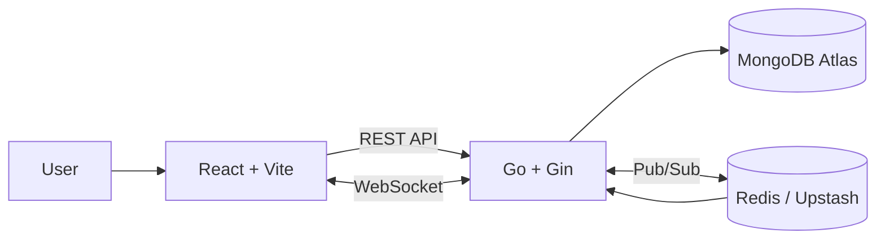

go run ./cmd/server
<h1 align="center">🚀 PulsePoll</h1>

<div align="center">

**Live polling, with results that move as your audience votes.**

Create polls, share links or QR codes, collect votes, and watch results update in real time.


</div>

---

# 🌐 Live Demo

### Frontend
https://pulse-poll-frontend-six.vercel.app

### Backend
https://pulse-poll-1-fb3p.onrender.com

### Health Check
https://pulse-poll-1-fb3p.onrender.com/api/health

---

# 📖 Overview

PulsePoll is a full-stack real-time polling application designed for classrooms, meetings, workshops, presentations, and public events.

Users can create polls, share them instantly using links or QR codes, vote from any device, and watch results update in real time without refreshing the page.

---

# ✨ Features

## 🔐 Authentication

- User Signup
- User Login
- JWT Authentication
- Password Hashing with bcrypt
- Protected Poll Management Routes

## 📊 Poll Management

- Create Polls
- Multiple Voting Options
- Poll Expiration Support
- Manual Poll Closing
- Poll Creator Attribution

## ⚡ Real-Time Updates

- WebSocket-Based Live Updates
- Redis Pub/Sub Integration
- Instant Vote Synchronization
- Live Viewer Count
- Poll Status Updates

## 📈 Analytics

- Total Polls
- Active Polls
- Total Votes
- Total Views
- Per-Poll Statistics

## 🎨 User Experience

- Responsive Design
- Dark Mode Support
- QR Code Sharing
- Copy Link Toast Notifications
- Percentage-Based Results
- Mobile-Friendly Interface

---

# 🚀 Extra Features

### ✅ QR Code Sharing

Generate QR codes for every poll so users can instantly access and vote from mobile devices.

### ✅ Percentage-Based Results

Visual result bars display both total votes and percentages for better analysis.

### ✅ Copy Link Feedback

Users receive instant toast notifications when poll links are copied.

### ✅ Poll Creator Information

Displays creator name and poll creation details for transparency.

### ✅ Live Viewer Count

Shows how many users are currently viewing a poll.

### ✅ Real-Time Polling

Results update instantly using Redis Pub/Sub and WebSockets.

---

# 🏗️ System Architecture



### Architecture Highlights

- MongoDB stores users, polls, and votes.
- Redis manages live counters and Pub/Sub events.
- WebSockets broadcast changes instantly.
- Backend automatically rebuilds counters if Redis data is unavailable.

---

# 📡 API Endpoints

All REST endpoints are prefixed with:

```text
/api
```

| Method | Endpoint | Description |
|----------|-----------|-------------|
| GET | /health | Health check |
| POST | /auth/signup | Register account |
| POST | /auth/login | Login user |
| POST | /polls | Create poll |
| GET | /polls/mine | User polls |
| GET | /polls/:id | Poll details |
| GET | /polls/:id/results | Poll results |
| POST | /polls/:id/votes | Submit vote |
| POST | /polls/:id/close | Close poll |
| GET | /analytics | Analytics dashboard |

### WebSocket Endpoint

```text
/ws/polls/:id
```

---

# 🛠️ Tech Stack

## Frontend

- React 19
- Vite
- React Router
- WebSocket Client
- QR Code Generation

## Backend

- Go
- Gin Framework
- JWT Authentication
- bcrypt Password Hashing

## Database

- MongoDB Atlas

## Realtime Infrastructure

- Redis
- Redis Pub/Sub
- WebSockets

## Deployment

- Vercel (Frontend)
- Render (Backend)

---

# ⚙️ Environment Variables

## Backend

```env
PORT=10000

MONGO_URI=your_mongodb_uri

MONGO_DB=livepoll

REDIS_URL=your_redis_url

JWT_SECRET=your_jwt_secret

FRONTEND_URL=https://pulse-poll-frontend-six.vercel.app
```

## Frontend

```env
VITE_API_URL=https://pulse-poll-1-fb3p.onrender.com

VITE_WS_URL=wss://pulse-poll-1-fb3p.onrender.com
```

---

# 🚀 Local Development

## Backend

```bash
cd backend

go mod download

go run ./cmd/server
```

## Frontend

```bash
cd frontend

npm install

npm run dev
```

Frontend URL:

```text
http://localhost:5173
```

---

# 🧪 How It Works

### Create Account

- Sign up with email and password
- Login securely

### Create Poll

Example:

```text
Which AI tool do you use most?
```

Options:

```text
ChatGPT
Microsoft Copilot
Claude
Gemini
```

### Share Poll

- Copy Link
- QR Code Sharing

### Vote

- Open poll from another browser/device
- Cast vote instantly
- Watch live updates and viewer tracking

---

# 📊 Analytics Dashboard

Poll creators can monitor:

- Total Polls
- Active Polls
- Total Votes
- Total Views
- Live Viewer Count
- Per-Poll Engagement Statistics

---

# 🏆 Challenges Faced

The biggest challenge was deploying and integrating multiple cloud services.

Issues encountered included:

- MongoDB Atlas authentication problems
- Redis connectivity issues
- API route mismatches
- CORS configuration errors
- Frontend-backend integration debugging

These issues were resolved through deployment log analysis, environment variable configuration, backend routing fixes, and cloud service troubleshooting.

---

# 🤖 AI Usage

AI tools such as Microsoft Copilot and ChatGPT were used during development for:

- Understanding deployment errors
- Debugging configuration issues
- Reviewing code
- Learning implementation approaches
- Troubleshooting cloud services

AI acted as a development and debugging assistant while implementation, deployment, testing, and verification were completed manually.

---

# 🎥 Demo Video

Demo Video:

```text
PASTE_YOUR_YOUTUBE_OR_GOOGLE_DRIVE_LINK_HERE
```

---

# 🔗 Links

### GitHub Profile
https://github.com/tfregixx

### Project Repository
https://github.com/tfregixx/Pulse-Poll

---

# 📄 License

This project is intended for educational, learning, and portfolio purposes.


