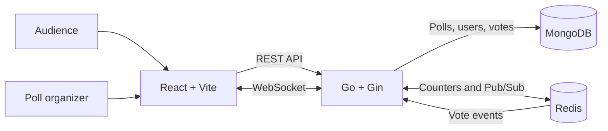

<h1 align="center">PulsePoll</h1>

<div align="center">

**Live polling, with results that move as your audience votes.**

Create a question, share a link or QR code, and follow participation in real time.


[Features](#features) · [Quick start](#quick-start) · [Configuration](#configuration) · [Deployment](#deployment)

</div>

---

## Overview

PulsePoll is a full-stack polling app for meetings, classes, events, and any moment when a group needs to decide together. Organizers create and manage polls; anyone with a poll link can vote. Results and viewer counts update live without refreshing.

## Problem Statement

Build a live polling tool where users can create a poll, share its link, and collect votes from an audience. Everyone watching should see results update in real time as votes arrive, without refreshing the page.

## Features

| For voters | For organizers | Under the hood |
| --- | --- | --- |
| Public poll pages and duplicate-vote checks per browser ID | Authenticated poll creation and management | React, Vite, and a responsive interface |
| Shareable links and downloadable QR codes | Live vote totals, percentages, and viewer counts | Go and Gin API with WebSocket updates |
| Real-time result updates | Poll expiration and close controls | MongoDB persistence and Redis Pub/Sub |
| Clear poll status and creator details | Per-poll and aggregate analytics | Docker Compose for local development |

## Architecture



MongoDB is the durable source of truth for users, polls, and votes. Redis keeps live counters and distributes result events; the Go service broadcasts updates to connected poll pages. If cached counters are unavailable, the backend can rebuild them from MongoDB.

## Quick Start

### Docker Compose

**Prerequisites:** Docker Desktop with Docker Compose.

1. Create the local environment file:

	```sh
	cp .env.example .env
	```

2. Replace `JWT_SECRET` in `.env` with a long, random value.
3. Start the stack:

	```sh
	docker compose up --build
	```

4. Open [http://localhost:5173](http://localhost:5173), create an account, and make a poll.
5. Open a poll in another browser or device to try voting and live updates.

Stop the stack with `Ctrl+C`. MongoDB and Redis data are stored in Compose volumes.

### Local Services

For a non-Docker setup, run MongoDB and Redis locally first. In separate terminals:

```sh
cp backend/.env.example backend/.env
cd backend
go run ./cmd/server
```

```sh
cp frontend/.env.example frontend/.env
cd frontend
npm install
npm run dev
```

The frontend expects the API at `VITE_API_URL` and the WebSocket endpoint at `VITE_WS_URL`. These values are set in the frontend environment file and are embedded during the Vite build.

> **Local CORS:** The current backend allowlist is configured for the deployed Vercel origin. To use the local frontend, add `http://localhost:5173` to `AllowOrigins` in `backend/cmd/server/main.go`. The `FRONTEND_URL` environment value does not currently configure this middleware.

## Configuration

| Variable | Used by | Purpose |
| --- | --- | --- |
| `PORT` | Backend | HTTP server port; defaults to `8080`. |
| `MONGO_URI` | Backend | MongoDB connection string. Use a local URI for development or a secured Atlas URI in production. |
| `MONGO_DB` | Backend | Database name; defaults to `livepoll`. |
| `REDIS_URL` | Backend | Optional Redis URL. Set this or `REDIS_ADDR`; URL schemes such as `rediss://` can carry TLS settings. |
| `REDIS_ADDR` | Backend | Redis host and port, for example `localhost:6379`. |
| `REDIS_PASSWORD` | Backend | Redis password, when required by the provider. |
| `REDIS_TLS` | Backend | Set to `true` when connecting by address to a Redis service that requires TLS. |
| `JWT_SECRET` | Backend | Signing secret for authentication tokens. Replace the development value with a strong random secret. |
| `FRONTEND_URL` | Compose/config | Frontend origin setting. Note that the current CORS middleware uses an explicit origin in `main.go` instead. |
| `VITE_API_URL` | Frontend | Backend origin, such as `https://your-service.onrender.com`; do not append `/api`. |
| `VITE_WS_URL` | Frontend | WebSocket origin, such as `wss://your-service.onrender.com`; do not append `/ws`. |
| `API_PORT`, `WEB_PORT` | Compose | Host ports for the API and frontend containers; defaults to `8080` and `5173`. |

## API Reference

All REST endpoints are prefixed with `/api`.

| Method | Endpoint | Access | Description |
| --- | --- | --- | --- |
| `GET` | `/health` | Public | Service health check. |
| `POST` | `/auth/signup` | Public | Create an account. |
| `POST` | `/auth/login` | Public | Sign in and receive a token. |
| `GET` | `/polls/:id` | Public | Read poll details and creator name. |
| `GET` | `/polls/:id/results` | Public | Read current results. |
| `POST` | `/polls/:id/votes` | Public | Submit a vote. |
| `POST` | `/polls` | Authenticated | Create a poll. |
| `GET` | `/polls/mine` | Authenticated | List your polls. |
| `GET` | `/analytics` | Authenticated | Read aggregate and per-poll analytics. |
| `POST` | `/polls/:id/close` | Authenticated | Close a poll you own. |

The live WebSocket endpoint is `/ws/polls/:id` (outside the `/api` prefix).

## Deployment

### Backend on Render

1. Create a Web Service connected to this repository.
2. Set the root directory to `backend` and use the repository Dockerfile.
3. Configure `MONGO_URI`, `MONGO_DB`, `REDIS_URL` or `REDIS_ADDR`, `REDIS_PASSWORD` if required, `REDIS_TLS` if required, and a strong `JWT_SECRET`.
4. Use `/api/health` as the health-check path.

### Frontend on Vercel

1. Import the repository and set the root directory to `frontend`.
2. Use the Vite preset and configure `VITE_API_URL` and `VITE_WS_URL` with the public Render service origins.
3. Deploy, then ensure the backend CORS allowlist includes the deployed Vercel origin.

The SPA rewrite is configured in `frontend/vercel.json`. Vite variables are build-time values, so redeploy the frontend after changing them. If the Vercel project has a different production domain, update the explicit CORS origin in `backend/cmd/server/main.go` before deploying the backend.

## Security Notes

- Never commit `.env` files or real credentials. Rotate any credential that has been committed or exposed.
- Use a unique, high-entropy `JWT_SECRET` in every deployed environment.
- Restrict MongoDB Atlas network access and use TLS-capable Redis endpoints where required. Do not expose database ports publicly.
- The current WebSocket upgrader accepts connections from any origin. Restrict `CheckOrigin` to trusted origins before relying on origin checks as a security boundary.
- The current HTTP CORS allowlist is explicit in `backend/cmd/server/main.go`; keep it aligned with the deployed frontend domain.

## Development Checks

Run backend tests:

```sh
cd backend
go test ./...
```

Build the frontend:

```sh
cd frontend
npm ci
npm run build
```


